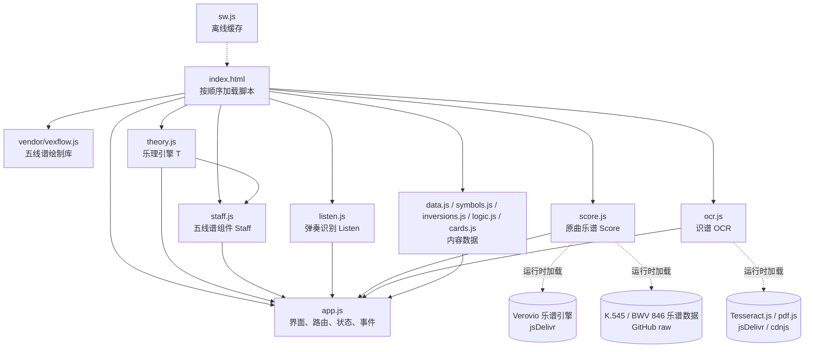

# ChordMatter 架构说明

纯静态网页应用（PWA）：没有后端，所有数据存在手机本机。部署在 GitHub Pages，iPhone 用 Safari「添加到主屏幕」后像 App 一样离线使用。

## 1. 设计原则（决定了下面所有结构）

| 原则 | 落在代码里的样子 |
|---|---|
| 一条练习流，不让用户做决策 | 「今天」页只有一个「继续」按钮，`nextStep()` 自动进入下一个没完成的步骤 |
| 只按真实结果记录，没有自评 | 弹奏靠麦克风（`listen.js`）或点屏幕键盘判定；答题按对错；所有结果写进 `S.log` |
| 一次只学一个点 | 三门入门课用同一个卡片引擎：一句话 + 演示 + 动手 3 次 + 复习 1 次，错了先讲解再加练 |
| 看不懂的东西随时能点开 | 全局扫描页面文字：和弦名、术语自动加下划线，点开浮窗解释 |
| 谱面和键盘永远一致 | 同一个 `T.voicing()` 决定所有地方画哪些音；右手在高音谱表、左手在低音谱表 |

## 2. 文件与模块



| 文件 | 职责 | 依赖 |
|---|---|---|
| `theory.js` | 乐理引擎 `T`：音名拼写、和弦解析、`voicing`（键盘上弹哪些音）、指法、调性分析（级数 / 功能 / 副属 / 借用）、终止式、进行模板 | 无（可在 Node 里单测） |
| `staff.js` | 五线谱组件 `Staff`：和弦大谱表、伴奏型一小节、五线谱日历；每个音符可点（发 `staffplay` 事件）；用 MutationObserver 自动挂载 `div.staff` | VexFlow、`T` |
| `listen.js` | 弹奏识别 `Listen`：麦克风频谱 → 起音检测 → 音级（chroma）→ 和弦模板匹配 / 单音判断 | Web Audio |
| `score.js` | 原曲完整乐谱 `Score`：Verovio 渲染 Humdrum 乐谱，学习段落高亮，每小节上方标和弦与级数，可播放、可点音符 | Verovio（运行时） |
| `ocr.js` | 识谱 `OCR`：截图 / PDF → 识别印出来的和弦字母 → 猜调；原谱图片存 IndexedDB | Tesseract.js、pdf.js（运行时） |
| `data.js` | 单元课程 `UNITS`、曲库 `SONGS`、跟唱曲 `SING`、伴奏型 `PATTERNS`、知识点 `KNOW`、参考视频搜索词 | — |
| `symbols.js` / `inversions.js` / `logic.js` | 三门入门课的卡片：`SYMS`（符号 20 课）、`INVS`（转位 10 课）、`LOGICS`（谱面逻辑 12 课）。每张卡 = `say` 一句话 + `demo` 演示 + `task(i)` 第 i 次练习 + 可选 `why` 讲解 | `T` |
| `cards.js` | 卡册 `CARDS`、积分解锁的曲目 `GIFT_SONGS` | — |
| `app.js` | 其余一切：存储、音频、路由与视图、练习引擎、评级、日历、全局下划线、事件 | 以上全部 |
| `sw.js` | Service Worker：网络优先，离线或服务器出错（如 GitHub 部署中的 503）时用本机缓存 | — |
| `tools/` | 自查与素材工具（见第 7 节） | Playwright、ffmpeg |

加载顺序就是依赖顺序（`index.html`）：VexFlow → theory → staff → listen → score → ocr → data → symbols → inversions → logic → cards → app。

## 3. app.js 内部分区

| 区块 | 内容 |
|---|---|
| 存储 | 状态对象 `S`、版本迁移 `migrate`、双份存储 `save`/`IDB`、每日快照、持久化申请、`logEv` 记录、`nextStep` 练习流 |
| 音频 | 合成钢琴 `A.note`、旋律音色 `A.tone`、节拍器 |
| 键盘 SVG | `kb(notes, opts)`：琴键、指法数字、左手颜色、可点 |
| 通用 UI | `toast`、和弦卡片、进行条、`playProg` |
| 课程逻辑 / 题目生成器 | 单元掌握度、`GEN.u0…u13` 14 类题 |
| 视图 | `render()` 路由分发 + 各页面 `vXxx()` |
| 测验 / 和弦库 / 琶音 / 曲库 | 对应页面；和弦页结果固定在上方 |
| 即兴伴奏 | 简谱解析、时间线、伴奏型图解、跟唱、每日配和弦小考 |
| 简单模式 | `degLabel`（6m、5⁷/2）、`chordExplain` 大白话 |
| 练习引擎 | `drillStart`/`drillJudge`：麦克风或点键盘，弹对才往下走 |
| 背谱（弹下来） | 四层：五线谱 + 标注 → 只留标注 → 只留级数 → 什么都不留 |
| 原曲乐谱 / 识谱 | `vScore`、`vScan`、我的原谱 |
| 入门课卡片引擎 | `vSym`、`symRep`、`symJudge`（错题讲解 `symWhy`）、课程注册 `COURSES` |
| 评级与卡册 | `award`（S–D）、`unlockCard`、抽卡浮层（只在结果页或非练习页弹出） |
| 练习时长 / 五线谱日历 | 停留在练习页且屏幕亮着才计时；一天一小节 |
| 全局下划线 | `linkChords`（和弦名）、`linkTerms`（39 个术语 → 课）、浮窗 |
| 事件 | 全局一个 `click` 监听，按 `data-act` 分发 |

## 4. 路由

地址用 `#名字-参数`（只用字母数字和连字符），`render()` 按第一段分发：

| 路由 | 页面 | 路由 | 页面 |
|---|---|---|---|
| `#today` | 今天（练习流） | `#song-<id>` | 曲目：原谱 → 和弦格子 → 谱面逻辑 |
| `#path` | 路径（所有课程入口） | `#mem-<id>` | 弹下来（背谱四层） |
| `#sym-<id>` / `#sym-next` | 入门课卡片（三门课共用） | `#score-<id>` | 原曲完整乐谱 |
| `#sym` `#inv` `#logic` | 三门入门课目录 | `#edit-<id>` / `#scan` | 编辑曲目 / 识谱 |
| `#unit-<id>` | 单元课文 | `#acc` `#sing-<id>` `#acctest` | 伴奏、跟唱、配和弦小考 |
| `#quiz-<id>` / `#quiz-today` | 测验 | `#arp-<和弦>` | 琶音热身 |
| `#chords` | 和弦库 | `#know` `#know-<id>` | 知识点 |
| `#me` | 记录、日历、数据 | `#cards` | 卡册 |

带 `-today` 后缀的路由属于「今天」的练习流，完成后显示「继续」。

## 5. 数据存储

全部在本机，没有服务器、没有账号。

### 5.1 状态对象 `S`（`localStorage['hexian.v1']`，同时镜像到 IndexedDB）

| 字段 | 内容 |
|---|---|
| `v` | 数据版本（当前 3），旧数据启动时经 `migrate()` 升级。v3 把「屏幕上学会」和「琴上弹过」分开：旧记录里只有带收音证据（`m: 'mic'`）的才算琴上弹过 |
| `days[日期]` | 当天 4 步是否完成（`warm/learn/quiz/song`），以及每步在哪种模式下完成（`warmM` 等：`piano` / `away`）、练习秒数 `sec`、今日琶音无错遍数 `clean`、今日入门课数 `symToday`、是否配过和弦 `acc` |
| `log[]` | 真实记录（最多 800 条）：`pk` 上琴补弹、`q` 答题、`arp` 琶音、`mem` 弹下来、`acc` 配和弦、`sym` 入门课作答、`grade` 评级、`card` 抽卡、`piece` 背下一首、`sing` 跟唱、`scan` 识谱 |
| `units[id]` | 单元最近 12 题对错、是否已掌握（≥10 题且 ≥80% 自动解锁下一单元） |
| `sym[id]` | 入门课卡片是否学会 |
| `songs[id].level` / `.away` | 琴上（收音确认）弹下来的层级 0–4 / 屏幕上点出来的层级 0–4 |
| `pk['sym:id' / 'arp:C']` | 学习状态台账：`a` 第一次学会的日期，`p` 第一次在琴上弹过的日期，`pn` 琴上次数。三种状态：未学 / 已学 · 未上琴 / 琴上弹过。入门课里没有「在键盘上点」题的课不需要上琴 |
| `arp[和弦]` | 琶音速度 BPM、连续无错遍数、连续出错遍数（3 遍无错 +4，2 遍出错 −4） |
| `pts` `ptsNext` `cards` `foil` `pendingGift` | 积分、下一张卡的门槛（每 500 分）、已解锁卡、闪卡、待弹出的卡 |
| `custom[]` | 自己添加 / 识谱 / 编辑过的曲目 |
| `xp` `pro` `place` `micOK` `backupAt` `savedAt` | 经验值、专业写法开关、全局模式 有钢琴（`piano`）/ 没钢琴（`away`）、麦克风已授权、上次备份时间、最后保存时间 |

### 5.2 IndexedDB

| 数据库 / 表 | 键 | 内容 |
|---|---|---|
| `hexian-state` / `kv` | `state` | `S` 的第二份（localStorage 被 iOS 清掉时自动恢复，按 `savedAt` 取新的那份） |
| | `snap-YYYY-MM-DD` | 每日快照，保留最近 7 天 |
| `hexian-scores` / `pages` | 曲目 id | 用户上传的原谱图片（JPEG dataURL 数组）；删除曲目时一并删除 |

### 5.3 防丢失措施
1. 首次点击时 `navigator.storage.persist()` 申请持久存储；主屏幕 App 不受 iOS 7 天清理限制。
2. 两份存储 + 每日快照。
3. 「我」页面显示存储状态；「导出备份」走 iPhone 分享面板（可存到「文件」/ iCloud），「导入备份」经 `migrate()` 兼容旧版本。

## 6. 关键流程

### 和弦从哪来（来源与依据）
- 每首曲子有 `src`：`printed` 和弦印在谱上 / `analyzed` 按谱上的音分析 / `simplified` 学习用简化（没逐小节对过原谱）。曲目页顶部「这些和弦从哪来」说明，并声明「播放进行」是合成和弦、不是原曲录音。
- `harmony.js`（由 `tools/make-harmony.js` 从逐小节转写 JSON 生成）给 Always Online、City of Stars 改编版加上：
  - `ev[小节]`：原谱第几页第几行、左手的音、右手和声音、谱上有没有印和弦、把握程度、说明（只写和声相关，不复述旋律）。点曲目页任意一格先显示这些依据。
  - `orig.score.kern`：新造谱。左手是逐音转写的原谱左手，右手是按核对过的和弦配的柱式和弦，没有旋律；小节号和原谱一一对应，可分段、可听、可点音。
- 转写流程：裁剪每行谱、放大逐小节读 → 和 data.js 的标注逐小节比对 → 不一致的小节人工看图裁决（例：AO 第 24、47、65 小节，City of Stars 第 13、36 小节因此更正）。

### 和弦体块（和弦格子里，`chordShape`）
每个格子里一小块迷你大谱表：每个音换成一根和音符头一样宽的短横条（相邻二度错开），竖直位置 = 它在五线谱上的位置（按音名和八度算，中央 C 画加线），颜色 = 感觉色（跟着键盘图层的「感觉色」开关）。左手低音在低音谱表、颜色浅一点。一眼看出和弦是挤成一团还是拉开、整块往上还是往下走。

### 键盘图层（和弦格子下面，`klPanel`）
- 键盘 E2–G5，用真实音高显示当前和弦：左手低音（粗边圆点）+ 右手和弦（`T.voicing`）。点格子、‹ ›、或播放和弦进行时跟着换。
- 三层可开关：调内音（铺底）、感觉色（圆点按稳走紧上色）、和弦音（圆点里写 R 3 5 7 / 级数 1–7 / 音名）；「只看」R 3 5 7 9 可单独隐藏（例如只看 3 和 7 看导音怎么走）。设置存在 `S.kl`。

### 自查里的两项「静默错误」检查
- 没有重名函数：后定义的同名函数会悄悄覆盖前面的。
- 关键界面不为空（`tools/test-views.js`）：逐页确认卡片、键盘图层圆点、和弦格子、色带、瀑布流入口等都有内容——一行代码被注释吃掉这类错误不会报错，只会让一块内容变空。

### 翻页（`pager` / `pagerInit`）
主要内容放上面，细节一页一页左右翻（横向 scroll-snap，可滑动也可点页签，底部小圆点）。翻页区高度跟着当前页走（ResizeObserver），当前页记在 `PG[id]`，重新渲染后留在原页。
- 组合和弦：上面只放这一串（和弦进行 + 和弦体块 + 一句说明）；下面「变体 / 填空 / 曲子里 / 跟练 / 琴上 / 谱」。
- 和弦页：上面是和弦本身；下面「小进行 / 曲子里 / 练」。

### 曲目 vs 伴奏（两个列表页的分工）
- **曲目** = 弹一首曲子：看谱 → 认和弦 → 弹下来（钢琴曲 / 改编谱，分析 + 背谱）。卡片：类型、整首和声色条、调、和弦来源、背谱进度。类型自动识别（`autoTags`：古典 / 影视 / 流行 / 儿歌民谣 / 我的谱，外加大调小调、七和弦多、有扒谱、有版权），用户可在卡片的「标签」里改或加自定义标签（`S.tags[id]`）。按标签筛选。
- **伴奏** = 给旋律配伴奏：一首歌 × 一种伴奏型（即兴）。卡片：拍子、第一句旋律简谱、用到的和弦（按功能上色）、上次选的伴奏型。按拍子 / 风格 / 和弦数筛选。
- 两边都能切换卡片 / 条状（`S.lv`）；卡片竖屏 2 列、横屏 3 列、更宽 4 列。

### 页面结构：一屏最多三个视觉重点
- 曲目页三个分页：**谱**（一次只看一段，段落按钮横向滑动；谱 + 和弦 / 瀑布流 / 和弦格子 / 原曲↔和弦）、**结构**（和声色带 + 谱面逻辑 + 说明）、**练**（弹下来、上下对比、跟录音弹、这首里的组合和弦、只听和弦进行、背谱方法）。顶部只有一行小按钮，说明点 ⓘ 弹出。
- 伴奏页三个分页：**① 看谱**（伴奏型 + 双手谱：右手旋律 + 歌词、左手伴奏型）、**② 跟弹跟唱**（大字现在 / 下一个；简谱默认收起，并注明只给跟唱看）、**③ 为什么这样配**（简谱上色 + 逐小节讲解 + 伴奏型图解）。

### 曲目页：谱和和弦一小节对一小节
- 默认「谱 + 和弦」：有 kern 的曲子（新造谱 / 公有领域原谱）用 Verovio 画，每小节正上方标「小节号 · 和弦 · 级数 · 稳走紧」（`barLabel`）；其他曲子用 VexFlow 和声骨架，`Staff.html({ start })` 画出与原谱一致的小节号。
- 点任何一小节（标注或空白处，`staffbar` 事件 / `data-act="barev"`）→ `barPop()` 在点的位置旁边弹出这一小节的依据和和弦解释，不用上下来回找。「只看和弦格子」保留为可选视图。
- 浮层定位以浮层自身范围为准（手机 = 屏幕，电脑预览 = 手机外框）。

### 组合和弦（`#combo`，数据在 `combos.js`）
- 常用和弦「词组」按级数存（4536、1564、2–5–1……），换调自动算和弦名；`cbFind` 按级数在曲库里找出现位置（换了调也算）。
- 「抠掉一个换成字」：被抠掉的位置显示它的功能字（稳 / 走 / 紧），同一功能的和弦（`cbCands`）每个都生成一个可播放的变体，并说明共用的音。
- 填空：选原版算对；选同一功能的别的和弦算「也成立的变体」但不算对；`S.combo[id] = { n, r }` 如实记录。在琴上弹这一串用同一个练习引擎（收音 / 屏幕）。

### 原曲 ↔ 和弦伴奏（`#cmp`，`fullscore.js`）
- 完整扒谱（两声部 kern）在 `private/full.js`，有版权，**不进仓库**，只内联进私人 artifact。`tools/check-kern.py` 校验每小节拍数。
- 三种看法：上下对比（右手 / 原曲左手 / 和弦左手）、练习版（右手原曲 + 左手和弦）、原曲；可按段落看，可分别播放（按谱表过滤音符）。歌词由用户粘贴、存本机，按顺序贴到旋律音下（`**text` 声部）。

### 瀑布流 + 和声色带（`roll.js`）
- 画布上音符变成彩条落到键盘：颜色 = 和弦功能（稳 深灰 / 走 蓝 / 紧 橙），右手实色、左手浅色；每个和弦开始处写「和弦 · 级数 · 稳走紧」，键盘上亮出正在响的键。
- 数据来源：完整扒谱（`FullScore.events`，连音线合并）/ 只有和弦的曲子与组合和弦（`rollFromBars`：左手低音 + 右手和弦）/ 伴奏歌曲（`rollFromSing`：旋律 + 选中的伴奏型）。
- 页面里只放入口卡片（`rollEntry`）；点进去是全屏沉浸的跟练层（`rollOpen` / `.rollfs`）：隐藏导航栏和右下角工具条，竖屏上下排、横屏左窄列放选项和按钮、右边整高给彩条；× 关闭回到原页面。
- 两种模式：跟着落下（有声音）；等你弹（每个和弦落到键盘就停，收音或点画面键盘弹对后继续，用的是同一个练习引擎）。
- 曲目页顶部的和声色带：一格一小节，按功能上色，点格子弹出这一小节的依据。

### 横屏
- `body.land`：真机横屏（`orientation: landscape` 且高度 ≤ 520）或电脑预览里点了「横屏预览」时加上。导航栏挪到左边竖排，播放 / 和声标注收进导航栏底部，内容占满宽度并避开左右安全区（`env(safe-area-inset-*)`）。
- 练习页（不显示导航栏）左边不留导航栏的位置。瀑布流在横屏时几乎占满屏幕高度。
- 转屏后宽度变化超过 60 像素就按新宽度重新排谱，并恢复到原来的大致滚动位置。
- 电脑预览的手机外框只在「宽 ≥ 760 且高 ≥ 600」时出现：iPhone 横屏宽 844 但只有 390 高，不会被误当成电脑。

### 在谱上点小节播放
- 点小节空白处（不是音符）= 播放这一小节；点音符 = 听这个音；点和弦标注 = 看这一小节的依据。
- 长按一个小节（480ms）进入多选，再点别的小节扩大范围，顶部出现「▶ 播放第 a–b 小节」。
- 每条小节线上方的小 ▶（Verovio：`g.pfm`；和声骨架：`staffplayfrom` 事件）= 从这一小节播放到结尾。
- `scorePlay(staffs, [a, b])` / `playSkeleton(s, [a, b])` 按小节范围过滤音符并从 0 开始计时。

### 瀑布流难度
简单（只右手和弦）→ 中等（左手低音 + 右手和弦）→ 困难（原曲两只手 / 旋律 + 伴奏型）。困难默认锁着：在中等用「等你弹」零错误弹完一遍才解锁，记在 `S.rollPass['页面:id']`。

### 播放
所有声音都接到 `A.bus`；`stopAll()` 调 `A.cut()` 把旧总线淡出断开，所以再次播放、切页面都会先停掉正在响的。

### 和弦浏览（`#browse`）
曲库里所有和弦按出现次数排列；按类型筛选时也列出曲库里没有的根音（点开去和弦页用小进行练）。选一个和弦，列出所有含它的 4 小节乐句（`phraseHtml`，小节号对原谱），可直接播放、跳到曲目页高亮。

### 双手谱（伴奏 → 每首歌）
`singKern()` 把简谱旋律（右手）和每个和弦（左手柱式或只弹根音）生成 Humdrum kern，用 Verovio 渲染，每小节标和弦与级数。

### 有钢琴 / 没钢琴
- 今天页顶部切换，存在 `S.place`，所有练习页共用。
- 没钢琴：琶音、背谱、入门课都在屏幕键盘上点；完成后记为「已学 · 未上琴」（`PK.mark(k, false)`、`songs[id].away`）。
- 有钢琴：练习页打开收音，只有收音听到弹对（`DR.mode === 'mic'`）才记为「琴上弹过」（`PK.mark(k, true)`、`songs[id].level`）。
- `pianoTodo()` 汇总所有「已学 · 未上琴」：有钢琴时排在今天页的「上琴补弹」里，`#pk` 列出全部，`#pk-<课id>` 用收音把这一课的点键盘题在琴上弹一遍。

**今天的练习流**：`nextStep()` 找第一个没完成的步骤 → 热身（琶音，3 遍无错）→ 学（入门课 2 张卡；三门课学完后改为单元课文）→ 练（8 题，当前单元 + 已掌握单元的薄弱复习，错题结尾重出）→ 用（弹下来当前层级）。每步完成时 `completeStep()` 记账，界面上只出现一个「继续」。

**练习判定**：`drillStart(targets)` → 在琴边：`Listen` 每次起音取「起音后 − 起音前」的频谱增量，算 chroma，与目标和弦模板比相似度（≥0.7 且不低于其他候选）→ 判对才前进；不在琴边：点屏幕键盘，音级集合（+最低音）一致才前进；麦克风不可用时自动切到点键盘。

**评级与抽卡**：每个练习结束 `award(正确率)` → S/A/B/C/D 与积分 → 达到门槛随机解锁一张未拥有的卡（集齐后给闪卡）→ 卡存为 `pendingGift`，只在结果页当场或回到非练习页时弹出，不打断练习。

**全局下划线**：`MutationObserver` 监听 `#view` 变化 → `linkChords` 把和弦名包成 `.chordref`，`linkTerms` 把术语包成 `.termref`（课自己的词不链接自己；音名、调名、「A 段」「B 站」不误标）→ 点击弹出浮窗。

## 7. 自查与工具

```bash
bash tools/run-all.sh
```

| 脚本 | 检查什么 |
|---|---|
| `test-theory.js` | 乐理引擎（Node，无需浏览器）：拼写、级数、副属 / 借用、转位只动最下面的音、终止式、进行模板 |
| `test-generators.js` | 14 类题 × 500 道：答案在选项里、选项不重复、没有 undefined |
| `test-notes.js` | 按音符实际画的位置点击：每个音符头只发它自己的音 |
| `test-flow.js` | 从零完成一天的 4 步，检查进度环与记录表 |
| `audit.js` | 遍历全部页面：自评按钮、未解释的术语、术语 → 课、页面错误 |
| `record-demos.js` + `demo-video.html` | 录制课程里的演示视频（录屏 + 同一套音色离线渲染 → ffmpeg 合成 mp4） |

## 8. 构建与部署

- 没有构建步骤，源码即产物。
- GitHub Pages 从 `gh-pages` 分支发布：`git push origin main && git push origin main:gh-pages`。
- 每次发布改 `sw.js` 里的缓存版本号（`hexian-vN`），保证手机拿到新文件。
- claude.ai 预览版是把所有脚本内联成一个 HTML 再发布（不在仓库里）；预览版不能用麦克风和原谱引擎。
- `private/`（用户自己的谱子图片）在 `.gitignore` 里，不进公开仓库。

## 9. 外部资源与授权

| 资源 | 授权 | 方式 |
|---|---|---|
| VexFlow | MIT | `vendor/` 内置 |
| Verovio | LGPL | 运行时从 jsDelivr 加载 |
| K.545 乐谱数据（Craig Sapp） | CC BY-NC-SA 4.0 | 运行时加载 |
| BWV 846 乐谱数据（CCARH） | 仅供学习 | 运行时从原站加载，不转存 |
| Tesseract.js / pdf.js | Apache 2.0 | 运行时加载 |
| Mario Ajero 小三和弦视频片段 | CC BY 2.5 | 截取 96 秒，加中文字幕 |
| 巴赫前奏曲录音（Sam Tennison） | 公有领域 | 内置 |
| `media/demo-*.mp4` | 本项目原创 | `tools/record-demos.js` 生成 |

## 10. 已知限制与技术债

- **`app.js` 是 1800 行的单文件**。各区块用分隔注释划分、靠闭包共享状态。功能继续增加时，优先拆出「入门课卡片引擎」「即兴伴奏」「评级与卡册」三块为独立文件。
- **识谱只认印出来的和弦字母**；手机截图的小字（尤其 Gm⁷ 这类上标）准确率低，界面上已如实提示，并引导用 iPhone「实况文本」复制。
- **麦克风识别**用合成钢琴音测试准确，真钢琴 + 房间噪音会差一些；可随时切到点键盘。
- **原谱引擎首次加载约 13 MB**；只有 K.545、BWV 846 有数字原谱，其他曲目靠用户上传截图。
- **曲目和声是学习用简化分析**（Always Online 由谱面左手推断），页面上注明了请对照原谱核对。
- **没有云同步**：换设备靠导出 / 导入备份。
